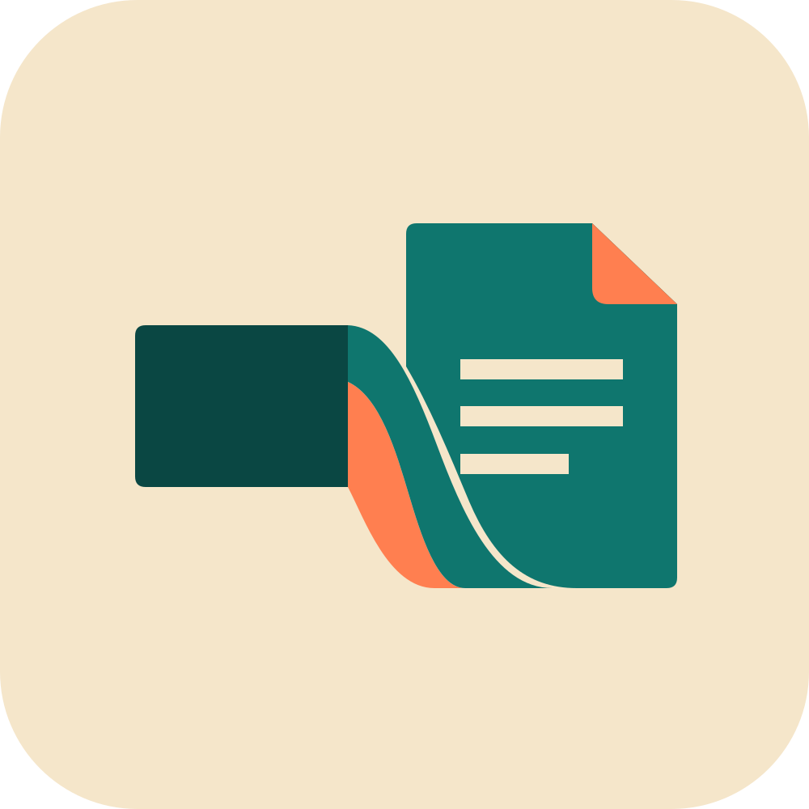
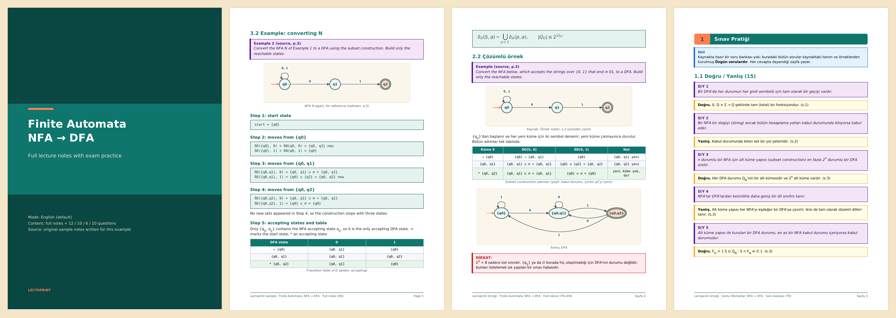

<p align="center"></p>

<h1 align="center">Lectoprint</h1>

<p align="center"><b>Your lectures, made readable.</b></p>

<p align="center"><a href="#english">English</a> · <a href="#turkce">Türkçe</a></p>

<a id="english"></a>

A Claude skill that turns lecture slides, textbook chapters, recitations or a chat into an exam-ready study PDF.

*Lecto-* comes from Latin *lectus*, "read", the same root as *lecture*.



## What it makes

Lectoprint builds one kind of output: a printable study PDF that follows the source slide by slide, explains every concept as **why → example → question**, and ends with an exam practice section and a key points summary.

**Three content types**

| | Lecture part | Exam practice (T/F · MC · Open-ended · Definition) |
|---|---|---|
| Full lecture notes | Every topic, every example, step by step | 12 · 10 · 6 · 10 (optional) |
| Quick review | About a third of the length: main definitions, one worked example per topic, all warnings and tips | 8 · 8 · 3 · 8 |
| Questions only | None | 15 · 15 · 15 · 15 |

**Three language modes**, built for students in English-medium engineering programmes:

| Mode | Explanations | Source quotes | Questions |
|---|---|---|---|
| English (default) | English | Original | English |
| Hybrid | Turkish | Original English + Turkish translation | English, as in the exam |
| Turkish | Turkish | Turkish | Turkish |

**What sets it apart from chat-based exam tutors**

- A **file you keep and print**, not a conversation you scroll back through.
- A **fixed question bank format** with model answers that cite the slide or page they rest on.
- **Source discipline**: definitions are quoted verbatim, anything not in the source is labelled *Original question* or *Assumption*.
- **Figures stay in**: automata, state diagrams and networks are redrawn exactly; everything else is cropped from the slides.
- **Real maths and code**: LaTeX-style formulas, and syntax highlighting for Python, Java, C, C++, JavaScript, SQL, Bash, MATLAB, Verilog and VHDL.
- Every calculation in the PDF is **checked by a script** before it goes in.

## Samples

All three are generated from original sample notes on finite automata, written for this repository:

- [English · full lecture notes](examples/Lectoprint_EN_Full_Notes.pdf)
- [Hybrid · quick review](examples/Lectoprint_Hybrid_Quick_Review.pdf)
- [Turkish · questions only](examples/Lectoprint_TR_Soru_Bankasi.pdf)

## Install on claude.ai

1. Download [`lectoprint.zip`](https://github.com/yavuzmeteafsar/lectoprint/releases/latest/download/lectoprint.zip) from the latest release. Do not use the "Source code" downloads; they contain the whole repository.
2. In Claude, go to **Customize → Skills**, click **+**, choose **Create skill → Upload a skill**, and upload the zip.
3. Code execution must be on (**Settings → Capabilities** on individual plans; an owner enables it for Team and Enterprise).

> [!IMPORTANT]
> Upload **the zip itself**, not the SKILL.md inside it and not an unpacked folder. The skill needs both `SKILL.md` and `scripts/doc_builder.py`; with SKILL.md alone it cannot build PDFs and will ask you to reinstall. Safari can unzip downloads automatically: if you end up with a `lectoprint` folder instead of `lectoprint.zip`, download it again or turn off "Open safe files after downloading".

To build the zip yourself: `python3 tools/package.py` writes `dist/lectoprint.zip`.

## Use

Attach your slides and ask, for example:

- "Make a study PDF from these slides."
- "Quick review PDF for tomorrow's quiz, hybrid mode."
- "Bu slaytlardan Türkçe soru bankası çıkar."

Lectoprint asks up to four short questions first (language, content type, questions at the end, figures) and skips any you already answered.

## Repository layout

```
lectoprint/            the skill (this folder is what goes into the zip)
  SKILL.md             instructions Claude follows
  scripts/doc_builder.py   PDF builder (ReportLab)
  scripts/find_figures.py  finds and crops figures in source PDFs
  scripts/extract.py       source text, and the pages to look at as images
  scripts/check_pdf.py     font, language, empty-page, margin and figure checks
  THIRD_PARTY_NOTICES.md   licenses of adapted code
examples/              sample PDFs and the scripts that build them
tests/                 tests of the scripts, run in CI
tools/package.py       builds dist/lectoprint.zip
```

## Development

```
pip install reportlab matplotlib pypdfium2
sudo apt-get install poppler-utils fonts-dejavu-core
python3 examples/src/build_en_full.py
python3 examples/src/build_hybrid_quick.py
python3 examples/src/build_tr_questions.py
python3 lectoprint/scripts/check_pdf.py examples/Lectoprint_EN_Full_Notes.pdf:en examples/Lectoprint_Hybrid_Quick_Review.pdf:hybrid examples/Lectoprint_TR_Soru_Bankasi.pdf:tr
python3 tests/test_find_figures.py
python3 tests/test_check_pdf.py
python3 tests/test_extract.py
python3 tests/test_layout_rules.py
```

## Credits

Figure detection adapted from [IEUStudia](https://github.com/mirzaisi/IEUStudia) (MIT License); see [THIRD_PARTY_NOTICES.md](lectoprint/THIRD_PARTY_NOTICES.md).

## License

[MIT](LICENSE). The PDFs use the DejaVu fonts installed on the system; they are not bundled and are covered by their own [license](https://dejavu-fonts.github.io/License.html).

---

<a id="turkce"></a>

## Türkçe

Ders slaytlarını, kitap bölümlerini, recitation'ları ya da bir sohbeti sınava hazır bir çalışma PDF'ine çeviren bir Claude skill'i.

*Lecto-*, Latince "okunmuş" anlamına gelen *lectus*'tan gelir; *lecture* kelimesiyle aynı köktür.

### Ne üretir?

Lectoprint tek bir çıktı üretir: kaynağı slayt slayt takip eden, her kavramı **neden → örnek → soru** sırasıyla anlatan ve bir sınav pratiği bölümüyle kritik noktalar özetiyle biten, basılabilir bir çalışma PDF'i.

**Üç içerik türü**

| | Konu anlatımı | Sınav pratiği (D/Y · ÇS · Açık uçlu · Tanım) |
|---|---|---|
| Tam konu anlatımı | Her konu, her örnek, adım adım | 12 · 10 · 6 · 10 (isteğe bağlı) |
| Hızlı tekrar | Yaklaşık üçte bir uzunluk: ana tanımlar, her konudan bir çözümlü örnek, bütün uyarılar ve ipuçları | 8 · 8 · 3 · 8 |
| Sadece sorular | Yok | 15 · 15 · 15 · 15 |

**Üç dil modu**, İngilizce eğitim veren mühendislik bölümlerindeki öğrenciler için:

| Mod | Açıklamalar | Kaynak alıntıları | Sorular |
|---|---|---|---|
| İngilizce (varsayılan) | İngilizce | Orijinal | İngilizce |
| Hibrit | Türkçe | İngilizce orijinal + Türkçe çeviri | Sınavdaki gibi İngilizce |
| Türkçe | Türkçe | Türkçe | Türkçe |

**Sohbet tabanlı sınav asistanlarından farkı**

- Geri kaydırarak bulmaya çalıştığın bir sohbet değil, **saklayıp basabileceğin bir dosya**.
- Dayandığı slayt ya da sayfayı gösteren model cevaplarla **sabit bir soru bankası formatı**.
- **Kaynak disiplini**: tanımlar birebir alıntılanır, kaynakta olmayan her şey *Özgün soru* ya da *Varsayım* olarak etiketlenir.
- **Şekiller kaybolmaz**: otomatlar, durum diyagramları ve ağlar birebir yeniden çizilir; geri kalan her şey slayttan kırpılır.
- **Gerçek matematik ve kod**: LaTeX tarzı formüller ve Python, Java, C, C++, JavaScript, SQL, Bash, MATLAB, Verilog ile VHDL için kod renklendirme.
- PDF'e giren her hesap önce **bir script ile doğrulanır**.

### Örnekler

Üçü de bu repo için yazılmış, sonlu otomatlarla ilgili özgün örnek notlardan üretildi:

- [İngilizce · tam konu anlatımı](examples/Lectoprint_EN_Full_Notes.pdf)
- [Hibrit · hızlı tekrar](examples/Lectoprint_Hybrid_Quick_Review.pdf)
- [Türkçe · sadece sorular](examples/Lectoprint_TR_Soru_Bankasi.pdf)

### claude.ai'ye kurulum

1. Son sürümden [`lectoprint.zip`](https://github.com/yavuzmeteafsar/lectoprint/releases/latest/download/lectoprint.zip)'i indir. "Source code" dosyalarını kullanma; onların içinde bütün repo var.
2. Claude'da **Customize → Skills**'e git, **+**'ya tıkla, **Create skill → Upload a skill**'i seç ve zip'i yükle.
3. Kod çalıştırma (code execution) açık olmalı (bireysel planlarda **Settings → Capabilities**; Team ve Enterprise'da yönetici açar).

> [!IMPORTANT]
> İçindeki SKILL.md'yi ya da açılmış klasörü değil, **zip'in kendisini** yükle. Skill'in hem `SKILL.md`'ye hem `scripts/doc_builder.py`'ye ihtiyacı var; yalnızca SKILL.md ile PDF üretemez ve yeniden kurmanı ister. Safari indirilen zip'leri otomatik açabilir: `lectoprint.zip` yerine bir `lectoprint` klasörü görürsen dosyayı tekrar indir ya da "İndirdikten sonra güvenli dosyaları aç" ayarını kapat.

Zip'i kendin oluşturmak için: `python3 tools/package.py` komutu `dist/lectoprint.zip` dosyasını yazar.

### Kullanım

Slaytlarını ekle ve örneğin şunu iste:

- "Make a study PDF from these slides."
- "Yarınki quiz için hızlı tekrar PDF'i, hibrit mod."
- "Bu slaytlardan Türkçe soru bankası çıkar."

Lectoprint önce en fazla dört kısa soru sorar (dil, içerik türü, sonda sorular, şekiller) ve isteğinde zaten cevapladıklarını atlar.

### Repo yapısı

```
lectoprint/            skill'in kendisi (zip'e giren klasör)
  SKILL.md             Claude'un uyduğu talimatlar
  scripts/doc_builder.py   PDF oluşturucu (ReportLab)
  scripts/find_figures.py  kaynak PDF'lerdeki şekilleri bulup kırpar
  scripts/extract.py       kaynağın metni ve resim olarak bakılacak sayfalar
  scripts/check_pdf.py     font, dil, boş sayfa, kenar ve şekil kontrolleri
  THIRD_PARTY_NOTICES.md   uyarlanan kodun lisansları
examples/              örnek PDF'ler ve onları üreten script'ler
tests/                 script testleri, CI'da çalışır
tools/package.py       dist/lectoprint.zip dosyasını oluşturur
```

### Geliştirme

```
pip install reportlab matplotlib pypdfium2
sudo apt-get install poppler-utils fonts-dejavu-core
python3 examples/src/build_en_full.py
python3 examples/src/build_hybrid_quick.py
python3 examples/src/build_tr_questions.py
python3 lectoprint/scripts/check_pdf.py examples/Lectoprint_EN_Full_Notes.pdf:en examples/Lectoprint_Hybrid_Quick_Review.pdf:hybrid examples/Lectoprint_TR_Soru_Bankasi.pdf:tr
python3 tests/test_find_figures.py
python3 tests/test_check_pdf.py
python3 tests/test_extract.py
python3 tests/test_layout_rules.py
```

### Teşekkür

Şekil bulma, [IEUStudia](https://github.com/mirzaisi/IEUStudia)'dan uyarlandı (MIT Lisansı); ayrıntılar [THIRD_PARTY_NOTICES.md](lectoprint/THIRD_PARTY_NOTICES.md) dosyasında.

### Lisans

[MIT](LICENSE). PDF'ler sistemde kurulu DejaVu fontlarını kullanır; fontlar pakete dahil değildir ve kendi [lisanslarına](https://dejavu-fonts.github.io/License.html) tabidir.
