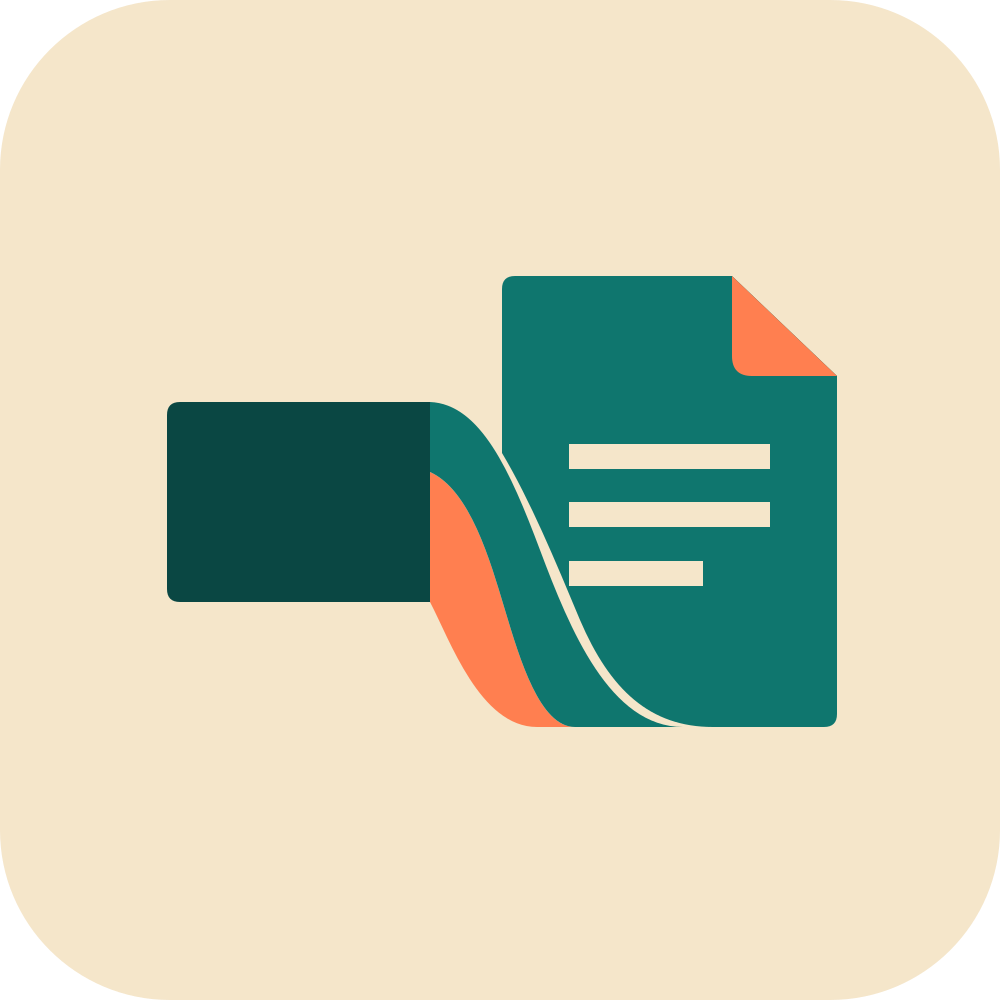
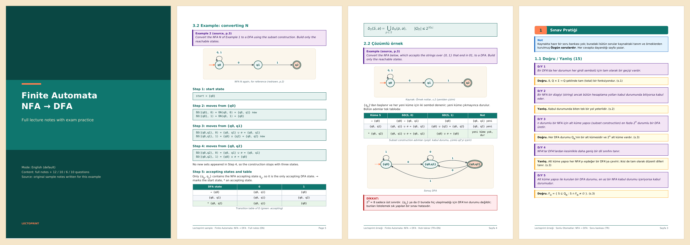

<p align="center"></p>

<h1 align="center">Lectoprint</h1>

<p align="center"><b>Your lectures, made readable.</b></p>

A Claude skill that turns lecture slides, textbook chapters, recitations or a chat into an exam-ready study PDF.

*Lecto-* comes from Latin *lectus*, "read", the same root as *lecture*.



## What it makes

Lectoprint builds one kind of output: a printable study PDF that follows the source slide by slide, explains every concept as **why → example → question**, and ends with an exam practice section and a key points summary.

**Three content types**

| | Lecture part | Exam practice (T/F · MC · Open-ended · Definition) |
|---|---|---|
| Full lecture notes | Every topic, every example, step by step | 12 · 10 · 6 · 10 (optional) |
| Quick review | About a third of the length: main definitions, one worked example per topic, all warnings and tips | 8 · 8 · 3 · 8 |
| Questions only | None | 15 · 15 · 15 · 15 |

**Three language modes**, built for students in English-medium engineering programmes:

| Mode | Explanations | Source quotes | Questions |
|---|---|---|---|
| English (default) | English | Original | English |
| Hybrid | Turkish | Original English + Turkish translation | English, as in the exam |
| Turkish | Turkish | Turkish | Turkish |

**What sets it apart from chat-based exam tutors**

- A **file you keep and print**, not a conversation you scroll back through.
- A **fixed question bank format** with model answers that cite the slide or page they rest on.
- **Source discipline**: definitions are quoted verbatim, anything not in the source is labelled *Original question* or *Assumption*.
- **Figures stay in**: automata, state diagrams and networks are redrawn exactly; everything else is cropped from the slides.
- **Real maths and code**: LaTeX-style formulas, and syntax highlighting for Python, Java, C, C++, JavaScript, SQL, Bash, MATLAB, Verilog and VHDL.
- Every calculation in the PDF is **checked by a script** before it goes in.

## Samples

All three are generated from original sample notes on finite automata, written for this repository:

- [English · full lecture notes](examples/Lectoprint_EN_Full_Notes.pdf)
- [Hybrid · quick review](examples/Lectoprint_Hybrid_Quick_Review.pdf)
- [Turkish · questions only](examples/Lectoprint_TR_Soru_Bankasi.pdf)

## Install on claude.ai

1. Download `lectoprint.zip` from the [latest release](../../releases/latest).
2. In Claude, go to **Customize → Skills**, click **+**, choose **Create skill → Upload a skill**, and upload the zip.
3. Code execution must be on (**Settings → Capabilities** on individual plans; an owner enables it for Team and Enterprise).

To build the zip yourself: `python3 tools/package.py` writes `dist/lectoprint.zip`.

## Use

Attach your slides and ask, for example:

- "Make a study PDF from these slides."
- "Quick review PDF for tomorrow's quiz, hybrid mode."
- "Bu slaytlardan Türkçe soru bankası çıkar."

Lectoprint asks up to four short questions first (language, content type, questions at the end, figures) and skips any you already answered.

## Repository layout

```
lectoprint/            the skill (this folder is what goes into the zip)
  SKILL.md             instructions Claude follows
  scripts/doc_builder.py   PDF builder (ReportLab)
examples/              sample PDFs and the scripts that build them
tests/check_pdf.py     font and language checks run in CI
tools/package.py       builds dist/lectoprint.zip
```

## Development

```
pip install reportlab matplotlib
sudo apt-get install poppler-utils fonts-dejavu-core
python3 examples/src/build_en_full.py
python3 examples/src/build_hybrid_quick.py
python3 examples/src/build_tr_questions.py
python3 tests/check_pdf.py examples/Lectoprint_EN_Full_Notes.pdf:en examples/Lectoprint_Hybrid_Quick_Review.pdf:hybrid examples/Lectoprint_TR_Soru_Bankasi.pdf:tr
```

## Türkçe

Lectoprint, İngilizce eğitim alan mühendislik öğrencileri için ders slaytlarını sınava hazır bir çalışma PDF'ine çeviren bir Claude skill'idir. Üç dil modu (İngilizce, hibrit Türkçe+İngilizce, tamamen Türkçe) ve üç içerik türü (tam konu anlatımı, hızlı tekrar, sadece sorular) vardır.

## License

[MIT](LICENSE). The PDFs use the DejaVu fonts installed on the system; they are not bundled and are covered by their own [license](https://dejavu-fonts.github.io/License.html).
